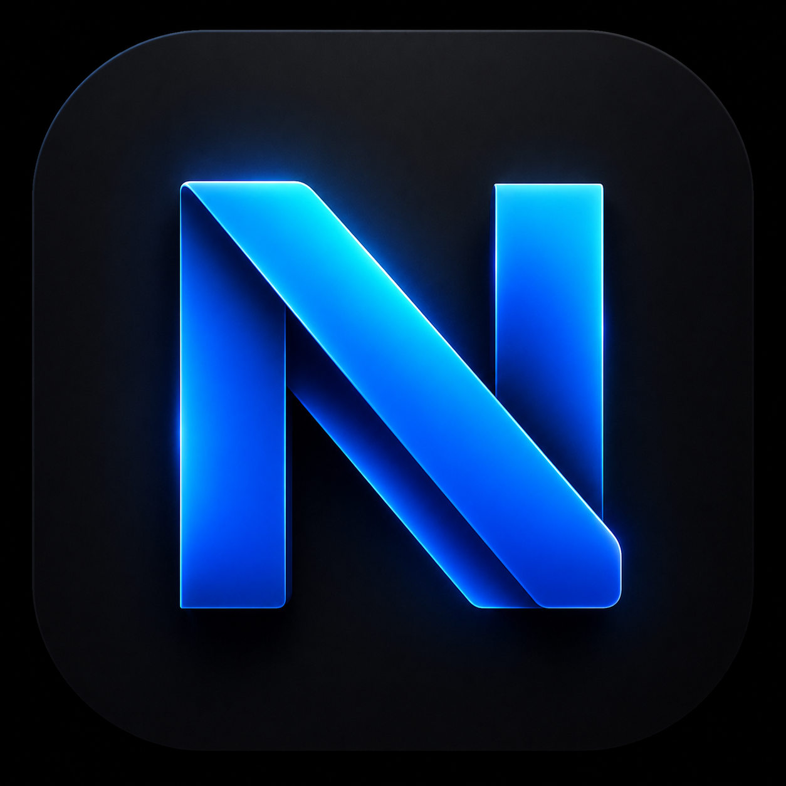

<p align="center">
  
</p>

# nudge

**The reminder you can't ignore.** · [nudgebuddy.net](https://nudgebuddy.net) · 35 users

Nudge is an AI assistant that texts you on iMessage. Tell it what's due and it'll hound you until you do it. Built for people with real ADHD, and for GSU students trying to snipe open course seats.

https://github.com/user-attachments/assets/a9fcf4bc-75de-4606-bc01-d9980494b115

> **About the source.** The code behind nudge is in a private repo. It's a live product with real users, so I don't publish it, but I'm happy to add you to the repo if you're reviewing my work. Email zacharyinyan [at] gmail [dot] com, or read how the hard parts were built on [zachinyang.com/work](https://zachinyang.com/work).

## What it does

You text it like a friend. It handles the rest.

```
You:   i have a bio exam friday at 8am
Nudge: bio exam friday 8am — want me to really nag you on this one?
You:   yes lol
Nudge: locked in. blowing your phone up thursday. you asked for this
```

When reminder time hits, Nudge texts you. If you don't reply, it escalates. 5 texts, progressively more unhinged. It stops the moment you respond.

## Features

- **iMessage native.** Shows up where your friends do. Blue bubbles, typing indicators, the whole thing.
- **Persistent nag mode.** Escalating texts, 30 seconds apart. Stops when you reply.
- **Natural language.** "remind me to submit my essay tomorrow at noon" just works.
- **One-off reminders.** "remind me to take my meds in 20 minutes" works too.
- **Multiple personas.** Coach, Snarky, or Anxious. Pick your vibe.
- **Syllabus photos.** Text a screenshot of your syllabus and it pulls out every due date.
- **Web dashboard.** See your assignments, pick your persona, mark things done.
- **OTP login.** Sign in via a code Nudge texts you. No passwords.
- **Location reminders.** "nag me when I get home to take out the trash." Uses iOS Shortcuts and geofencing.
- **SeatSnipe.** Monitors GSU Banner for open course seats and texts you the instant one opens. 152 students used it during fall 2026 add/drop, 100 of them in the first 24 hours.

## SeatSnipe

Built for GSU students during add/drop. Text a course name or CRN, and Nudge watches Banner around the clock until a seat opens.

```
You:   watch CSC 1301
Nudge: Found 3 sections for CSC 1301 — reply with a number:
       1. Sec 002, MW 11:00–12:15, Saghaeiannejad (40 seats open)
       2. Sec 005, TR 2:00–3:15, Williams (full)
       3. Sec 008, Online Async, Johnson (full)
You:   3
Nudge: Watching CSC 1301 Sec 008 (CRN 12345). I'll text you the second a seat opens.

[3 hours later]
Nudge: 🚨 A seat just opened in CSC 1301 Sec 008 — go register NOW before it's gone
```

- Polls Banner every 60 to 90 s in surge mode, 5 min normal, 15 min overnight
- Alerts fire only when a section goes from 0 seats to some, not on flapping
- 10 minute cooldown between alerts and 3 alerts per watch, then the watch retires and tells you how to re-arm it
- Up to 5 active watches per user
- Watches expire on their own once add/drop closes

GSU's Banner API has no public docs and answers 200 with empty results if you call it out of order. The client rebuilds the 3-step session-cookie handshake captured from the browser, with a mutex and a rate limiter so concurrent polls don't thrash the session, and a circuit breaker that pauses for 10 minutes after 5 errors. The full story is in [the seatsnipe write-up](https://zachinyang.com/work/seatsnipe-add-drop).

## How it's built

| Layer | Tech |
|---|---|
| Frontend / API | Next.js 15 (App Router), Vercel |
| Database | Neon (serverless Postgres) + Prisma |
| Job queue | BullMQ + Upstash Redis |
| iMessage bridge | BlueBubbles |
| AI | Anthropic API, a Claude agent with a tool-use loop across 14 tools |
| Auth | JWT via jose |
| Worker | Node.js + PM2 (persistent process) |
| Banner API | Custom TypeScript client with session cookie management |

```
iMessage → BlueBubbles → Webhook → Next.js API (Vercel)
                                         ↓
                                    AI Agent Loop
                                         ↓
                               BullMQ (Upstash Redis)
                                         ↓
                              Worker (PM2, persistent)
                             /                       \
                    Reminder jobs              SeatSnipe watcher loop
                                                      ↓
                                             Banner API polling
                                                      ↓
                                              Alert → iMessage
```

Serverless functions die after each request, so a delayed reminder can't just sleep. The Next.js route handles the webhook and a separate always-on worker consumes the queue and fires reminders on time, with recovery on boot so nothing is lost if the worker restarts. Duplicate texts are blocked from three independent sources (serverless retries, BullMQ retries, concurrent watcher ticks) with an atomic database claim that rolls back if the send fails, Redis `SET NX` dedup keyed on the message GUID, and deterministic BullMQ job ids.

## Personas

| Persona | Vibe |
|---|---|
| **Coach** | Warm, supportive, gets things done |
| **Snarky** | Dry humor, calls you out, still shows up |
| **Anxious** | Stressed on your behalf, endearingly flustered |

Change yours anytime in the dashboard or just tell Nudge.

---

Copyright © 2026 Zach Inyang. All rights reserved.
